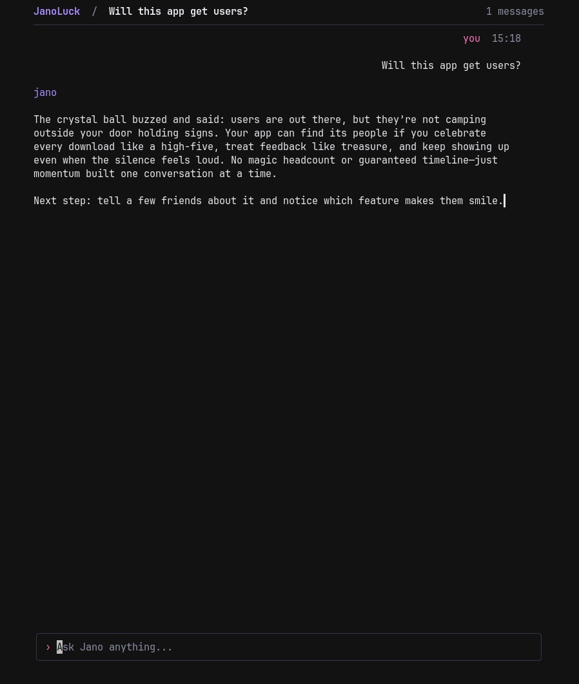
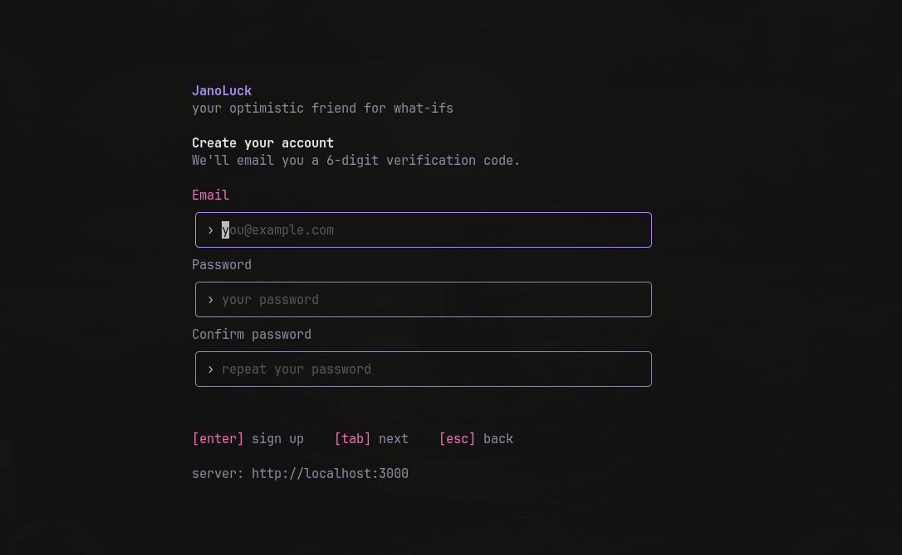

# JanoLuck

An AI fortune-telling chat app built with Go. Ask about love, career, money, or big decisions, and get a short, personal answer that streams into a terminal client.

## Demo

[Watch the demo video](demoContents/project_demo.mp4)

## Screenshots

| Chat                                       | SignUp                                     |
| ------------------------------------------ | ------------------------------------------ |
|  |  |

## Features

- **Streaming chat** - replies arrive token by token over SSE.
- **Modes** - built-in personas and your own custom prompts.
- **Personal profiles** - your answers are used as context for every fortune.
- **Semantic memory** - related past messages are found with pgvector and added as context.
- **Smart sessions** - AI-generated titles and rolling summaries.
- **Async workers** - emails, embeddings, moderation, analytics, and audits run on Kafka.
- **Transactional outbox** - events are stored with the data, then relayed to Kafka.
- **Auth & limits** - JWT access/refresh tokens, email verification, and Redis rate limiting.
- **Terminal UI** - a full Bubble Tea client for chat, modes, profiles, and passwords.

## Tech Stack

- **Language:** Go 1.27
- **API:** Chi v5
- **Database:** PostgreSQL 18 + pgvector, sqlc, goose
- **Messaging:** Apache Kafka
- **Cache:** Redis Stack
- **AI:** OpenRouter
- **Email:** Resend
- **CLI:** Bubble Tea, Lip Gloss
- **Local setup:** Docker Compose

## Architecture

Two entrypoints share the same `internal/` packages:

- `cmd/server` - HTTP API. Validates, embeds, retrieves context, streams replies, and writes events to the outbox.
- `cmd/worker` - Kafka consumers for email, session titles, summaries, embeddings, moderation, analytics, audits, and notifications.

Packages are organized by domain: `auth`, `users`, `sessions`, `chats`, `modes`, `LLM`, `email`, `kafka`, `outbox`, `moderation`, `embeddings`, `ratelimit`, `server`.

Chat flow:

```
POST /sessions/{id}/chats/stream
  → auth + rate limit
  → load profile, active mode, similar messages
  → stream LLM reply (SSE)
  → save messages + outbox events
```

## Setup

### Option 1: Docker Compose (recommended)

```bash
cp .env.example .env   # add OpenRouter, Resend, and JWT credentials
docker compose up -d
```

Compose starts Postgres, Kafka, Redis, runs migrations, then launches the API (`http://localhost:3000`) and worker.

### Option 2: Manual

Requires Go 1.27+, PostgreSQL with pgvector, Redis, and Kafka.

```bash
go mod download
cp .env.example .env
goose -dir sql/schema postgres "$DATABASE_URL" up

go run ./cmd/server     # API
go run ./cmd/worker     # workers, in a second terminal
go run ./cmd/cli        # terminal client
```

## Testing

```bash
go test ./...
go test ./... -cover
go test ./... -race
```

Tests use in-memory fakes, so no external services are needed.

## Contributing

Issues and pull requests are welcome. Keep changes consistent with the existing package layout, add tests, and make sure `go build ./...` and `go test ./...` pass.

## License

MIT License
